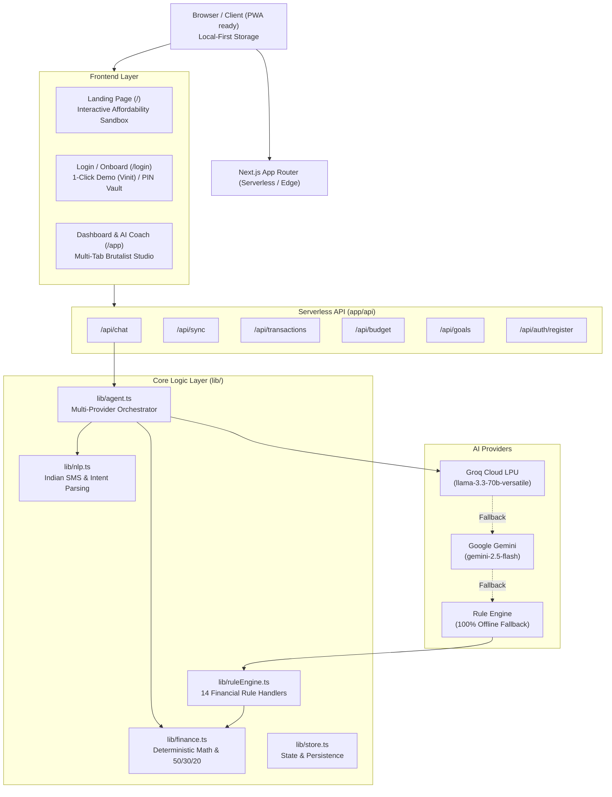

# Budget Buddy India — In-Depth Technical & Product Documentation

> **Production URL**: [https://budget-buddy-india-psi.vercel.app](https://budget-buddy-india-psi.vercel.app)  
> **Source Repository**: `https://github.com/vinith17-k/budget-buddy-india`  
> **Architecture**: Next.js 16 (App Router) + TypeScript + Groq LPU (`llama-3.3-70b-versatile`) + Deterministic TypeScript Financial Engine

---

## 1. Executive Summary & Core Philosophy

**Budget Buddy India** is a personal AI budget auditor designed specifically for the financial realities of young Indian earners, freelancers, and salaried professionals.

### The Core Philosophy: "Zero Financial Hallucination"
Large Language Models (LLMs) frequently hallucinate arithmetic, leading to inaccurate calculations for balances, runway days, or 50/30/20 splits.

**Budget Buddy solves this with strict architectural separation:**
1. **Mathematical Truth Layer (Pure TypeScript)**: Every calculation (safe-to-spend allowance, remaining days, daily burn rate, expense category envelopes, affordability verdicts) is executed by deterministic algorithms in `lib/finance.ts`.
2. **Natural Language Understanding Layer (`lib/nlp.ts`)**: Regex-based and keyword-driven intent resolver supporting Indian bank SMS formats (HDFC, SBI, ICICI, Axis, Paytm, PhonePe), currency colloquialisms (`₹4000`, `4k`, `1.5L`, `4000 bucks`), and 100+ Indian merchant mappings.
3. **Reasoning & Explanation Layer (`lib/agent.ts`)**: Powered by **Groq LPU** (`llama-3.3-70b-versatile`) with Google Gemini (`gemini-2.5-flash`) and offline Rule Engine fallbacks. The LLM acts as an auditor and communicator—it never guesses numbers.

---

## 2. System Architecture & Tech Stack



### Technology Breakdown
- **Framework**: Next.js 16.4.2 (App Router with Turbopack)
- **Language**: TypeScript 5 (Strict Mode)
- **Styling**: Tailwind CSS + Custom Brutalist Paper Design System (`app/globals.css`)
- **Typography**: `Rubik Dirt`, `Archivo Black`, `Space Mono`, `Caveat` (Google Fonts)
- **AI Acceleration**: `groq-sdk` with JSON function calling
- **Fallback AI**: `@google/genai` (Google Gen AI SDK)
- **Deployment Platform**: Vercel Serverless Platform with automated GitHub CI/CD

---

## 3. Directory & File Structure

```text
budget-buddy-india/
├── app/
│   ├── api/
│   │   ├── auth/register/route.ts       # User setup, custom income & 50/30/20 presets
│   │   ├── budget/[userId]/route.ts     # Category-wise budget fetch & updates
│   │   ├── chat/route.ts                # Main conversational coaching endpoint
│   │   ├── confirm-expense/route.ts     # Confirm pending card expense & award XP
│   │   ├── goals/[userId]/route.ts      # Target savings goal management
│   │   ├── insights/[userId]/route.ts   # Spending analytics & burn rate forecasts
│   │   ├── profile/[userId]/route.ts    # XP, level, streak, and spendable balance
│   │   ├── seed/[userId]/route.ts       # Reset or seed starter financial profile
│   │   ├── sync/route.ts                # LocalStorage <-> Server state sync
│   │   └── transactions/[userId]/route.ts # Transaction history & DELETE endpoint
│   ├── app/
│   │   └── page.tsx                     # Main interactive application dashboard
│   ├── login/
│   │   └── page.tsx                     # Login, 1-click Vinit demo, and new user setup
│   ├── globals.css                      # Paper textures, rough SVG filter, brutalist styles
│   ├── layout.tsx                       # Root layout with font imports and metadata
│   └── page.tsx                         # High-converting Brutalist Landing Page
├── lib/
│   ├── agent.ts                         # Groq/Gemini/Offline multi-tier orchestrator
│   ├── finance.ts                       # Mathematical logic (runway, balance, affordability)
│   ├── nlp.ts                           # Regex amount extractor, SMS parser, intent resolver
│   ├── ruleEngine.ts                    # 14 financial rule handlers for offline support
│   ├── store.ts                         # In-memory store + sync helper
│   └── types.ts                         # TypeScript interfaces (Profile, Transaction, Budget, Goal)
├── package.json                         # Node dependencies (groq-sdk, @google/genai, next, react)
└── tsconfig.json                        # Path mappings & TypeScript compiler options
```

---

## 4. Key Functional Modules Explained

### 4.1. Natural Language Processing & SMS Parser (`lib/nlp.ts`)
Handles Indian currency conventions and SMS notifications from major Indian banks:
- **Banks Supported**: HDFC, SBI, ICICI, Axis, Kotak, Paytm Payments Bank.
- **Amounts Handled**:
  - Raw numbers: `4000`, `450.50`
  - Indian Comma Format: `10,000`, `1,50,000`
  - Currency Prefixes & Suffixes: `₹4000`, `Rs. 4000`, `4000 inr`, `4000 bucks`
  - Multipliers: `5k` (₹5,000), `1.5L` (₹1,50,000)
- **100+ Merchant Keyword Categorization**:
  - **Food**: Swiggy, Zomato, Blinkit, Zepto, Instamart, Canteen, Mess, Chai, Dominos, McDonald's.
  - **Transport**: Uber, Ola, Rapido, Metro, Fastag, Petrol, IRCTC, Auto.
  - **Fun**: Netflix, Spotify, BookMyShow, PVR, Steam, Myntra, Zara.
  - **Housing**: Rent, BESCOM, Electricity, WiFi, Gas, Maintenance.
  - **Savings**: SIP, Zerodha, Groww, Mutual Fund, PPF, Emergency Fund.

### 4.2. Deterministic Financial Calculator (`lib/finance.ts`)
- **`getBalance(userId)`**: Computes income minus total expenses, checks minimum safety buffer (e.g. ₹500 or ₹1,000), and calculates `days_remaining` in the current calendar month.
- **`checkAffordability(userId, amount)`**: 
  - `Safe`: Purchase takes $\le 30\%$ of remaining safe-to-spend allowance.
  - `Risky`: User has the funds, but the purchase exceeds $30\%$ of safe allowance, or reduces daily burn runway significantly.
  - `Unaffordable`: Insufficient balance.
- **`audit50_30_20(userId)`**: Classifies spending into **Needs** (50%), **Wants** (30%), and **Savings** (20%) based on monthly income and alerts user to overextended envelopes.
- **`simulateWhatIf(userId, scenario, amount)`**: Projects how saving or cutting ₹X changes safe daily spend and emergency runway.

### 4.3. Multi-Tier AI Orchestrator (`lib/agent.ts`)
1. **Tier 1 (Groq Cloud LPU)**:
   - Uses `llama-3.3-70b-versatile` through `groq-sdk`.
   - Tool schemas: `check_affordability`, `log_expense`, `get_budget_status`, `get_spending_insights`, `run_whatif`, `get_goals`.
   - Ultra-fast token generation (~200ms) with conversational tone and tool execution.
2. **Tier 2 (Google Gemini)**:
   - Fallback if Groq is unavailable or unconfigured, utilizing `gemini-2.5-flash` with native function declarations.
3. **Tier 3 (Offline Rule Engine - `lib/ruleEngine.ts`)**:
   - Zero-dependency deterministic offline fallback.
   - Operates across 14 distinct intents without an external API key or network connection.

---

## 5. User Interface & Anti-Vibecoding Design System

The visual design system adheres strictly to a brutalist, tactile, paper-and-ink aesthetic:

### Design Tokens (`app/globals.css`)
- `--wall`: `#d4d4d0` (Warm concrete backdrop)
- `--spot`: `#f4f4f1` (Overhead spotlight glow)
- `--paper`: `#f4efe3` (Tactile vintage ledger paper)
- `--ink`: `#161616` (Deep stamp ink)
- `--acc`: `#f0481f` (Vibrant coral stamp red)
- `--line`: `rgba(0, 0, 0, 0.08)` (Subtle grid lines)

### Custom Components
- **Rough SVG Filter (`filter: url(#rough)`)**: Applies organic fractal noise turbulence to borders, making digital cards look like physically stamped, rough-cut paper.
- **Sticky Notes (`.note.y` & `.note.u`)**: Yellow and blue angled post-its with red pushpins (`.pin`) and cursive annotations in `Caveat`.
- **Ink Stamps (`.stamp` & `.stamp.hot`)**: Angled (-6deg) bordered labels (`AFFORDABLE`, `RISKY`, `BUDGET WARNING`).
- **Paper Receipt Tape Skeleton Loader (`.skeleton-tape`)**: Replaces generic bouncing dots with a receipt tape shimmer during AI calculations.
- **Tactile Mechanical Buttons**: Instant active press-down (`transform: translate(2px, 2px)`) simulating physical typewriter keys.

---

## 6. API Route Specification

| Route | Method | Description |
| :--- | :--- | :--- |
| `/api/chat` | `POST` | Core coaching endpoint. Accepts message, history, and `userId`. Returns assistant reply and optional `pending` confirmation card. |
| `/api/confirm-expense` | `POST` | Commits pending expense to transactions, updates budget percentages, and awards XP (+10 XP). |
| `/api/profile/[userId]` | `GET` | Returns user display name, XP, level, streak, quest count, and live balance. |
| `/api/budget/[userId]` | `GET` | Returns planned vs. spent amounts and percentage limits per category. |
| `/api/transactions/[userId]` | `GET`, `DELETE` | Retrieves recent transaction feed, or deletes a specific transaction by `?id=...`. |
| `/api/insights/[userId]` | `GET` | Returns total spent, daily average burn, days remaining, and month-end forecast. |
| `/api/goals/[userId]` | `GET`, `POST` | Retrieves or creates savings targets (e.g. Laptop, Emergency Fund). |
| `/api/sync` | `POST` | Ingests client `localStorage` store data to maintain serverless session state. |
| `/api/auth/register` | `POST` | Registers a new user with custom salary and fixed expense presets. |

---

## 7. Deployment & Environment Configuration

### Required Environment Variables
For production on Vercel or local testing (`.env.local`):
```env
# Optional: Enables high-speed Llama 3.3 70B reasoning via Groq LPU
GROQ_API_KEY=gsk_...

# Optional: Enables Google Gemini 2.5 Flash reasoning
GEMINI_API_KEY=AIzaSy...

# Optional: Set custom API base URL for mobile or external clients
NEXT_PUBLIC_API_URL=
```
*(Note: If neither key is provided, the application automatically functions via its offline rule engine).*

### Deploying to Vercel
```powershell
# 1. Install Vercel CLI
npm i -g vercel

# 2. Add Environment Variable
npx vercel env add GROQ_API_KEY production

# 3. Deploy Production
npx vercel deploy --prod --yes
```

---

## 8. Product Roadmap & Upcoming Enhancements

1. **The 48-Hour Impulse Shield**:
   - For purchases categorized as `RISKY`, a one-tap cooling-off vault with an automated 48-hour countdown timer.
2. **Downloadable / Printable Audit Receipt**:
   - Clean `@media print` layout generating a supermarket-style paper receipt summarizing monthly metrics for sharing.
3. **Bulk SMS Statement Dropzone**:
   - Multi-line textarea to parse up to 20 bank SMS messages at once and commit them in a single batch.
4. **Interactive Budget Slider Rebalancing**:
   - Physical sliders to shift allowances between envelopes (e.g. reduce *Fun* by ₹2,000 to instantly increase *Daily Safe Spend*).
